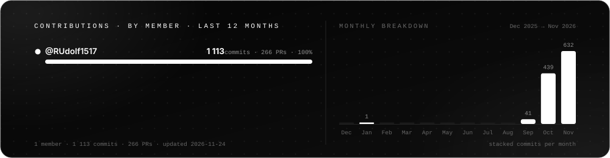
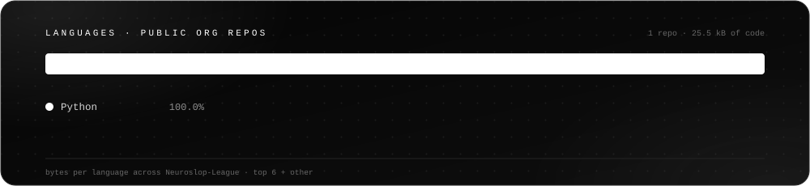

# Neuroslop League — `.github`

Organization profile repository for **[Neuroslop-League](https://github.com/Neuroslop-League)**.

- The organization's public profile README (shown on `github.com/Neuroslop-League`) lives in [`profile/README.md`](profile/README.md).
- The banner, per-member contribution card, and org language card live in [`assets/`](assets/) and are rebuilt automatically on every push to [`members.txt`](members.txt) or [`scripts/`](scripts/), as well as every 6 hours by [`.github/workflows/stats.yml`](.github/workflows/stats.yml).
- [`scripts/gen_org_langs.py`](scripts/gen_org_langs.py) also keeps the `Projects` table in [`profile/README.md`](profile/README.md) synced with public organization repositories.

## Adding members to the contribution chart

Because GitHub's standard `GITHUB_TOKEN` cannot always enumerate private organization memberships, the roster is maintained explicitly in [`members.txt`](members.txt) — one GitHub username per line:

```text
RUdolf1517
username2
username3
```

Any public org members returned by the API are included automatically as well. Committing an edit to [`members.txt`](members.txt) on `main` triggers an immediate card rebuild via GitHub Actions, or you can regenerate locally:

```bash
python3 scripts/gen_banner.py
GITHUB_TOKEN="$(gh auth token)" python3 scripts/gen_org_stats.py
GITHUB_TOKEN="$(gh auth token)" python3 scripts/gen_org_langs.py
```

## Cards preview

<picture>
  <source media="(prefers-color-scheme: dark)" srcset="assets/commits-dark.svg">
  <source media="(prefers-color-scheme: light)" srcset="assets/commits-light.svg">
  
</picture>

<picture>
  <source media="(prefers-color-scheme: dark)" srcset="assets/langs-dark.svg">
  <source media="(prefers-color-scheme: light)" srcset="assets/langs-light.svg">
  
</picture>
