<picture>
  <source media="(prefers-color-scheme: dark)" srcset="https://raw.githubusercontent.com/Neuroslop-League/.github/main/assets/banner-dark.svg">
  <source media="(prefers-color-scheme: light)" srcset="https://raw.githubusercontent.com/Neuroslop-League/.github/main/assets/banner-light.svg">
  
</picture>

<!-- =========================================================================
     SPACE FOR TEXT — INTRO / MANIFESTO
     Replace the placeholder below with your description of Neuroslop League.
     ========================================================================= -->

> *Placeholder for the **Neuroslop League** intro — who we are, why we teamed up, and why half of everything around here was prompted into existence.*

---

## About

<!-- Add the main text here: background, principles, how to join, links to chats or resources. -->

*Space reserved for text about what the organization builds and stands for.*

---

## Projects

<!-- Fill in the table as repositories are added to the organization. -->

| Project | What it is | Stack |
| :--- | :--- | :--- |
| **[project-1](https://github.com/Neuroslop-League)** | *Short description of the first project* | `Python` `AI` |
| **[project-2](https://github.com/Neuroslop-League)** | *Short description of the second project* | `Rust` `TypeScript` |
| **[project-3](https://github.com/Neuroslop-League)** | *Short description of the third project* | `...` |

---

## Members

<!-- Member roster. To include a member in the contribution chart below, add their GitHub username to members.txt in the .github repo root. -->

| Member | Role / note | Profile |
| :--- | :--- | :--- |
| **@RUdolf1517** | *role / description* | [github.com/RUdolf1517](https://github.com/RUdolf1517) |
| **@member-2** | *placeholder for a member* | — |
| **@member-3** | *placeholder for a member* | — |

---

## Member Contributions

<picture>
  <source media="(prefers-color-scheme: dark)" srcset="https://raw.githubusercontent.com/Neuroslop-League/.github/main/assets/commits-dark.svg">
  <source media="(prefers-color-scheme: light)" srcset="https://raw.githubusercontent.com/Neuroslop-League/.github/main/assets/commits-light.svg">
  
</picture>

Everything on this page is generated in-repo with zero third-party services:
<a href="https://github.com/Neuroslop-League/.github/blob/main/scripts/gen_banner.py">gen_banner.py</a> renders the banner,
<a href="https://github.com/Neuroslop-League/.github/blob/main/scripts/gen_org_stats.py">gen_org_stats.py</a>
pulls per-member contribution data from the GitHub GraphQL API for every login in
<a href="https://github.com/Neuroslop-League/.github/blob/main/members.txt">members.txt</a>
(plus any visible org members), and a workflow updates the cards every six hours.
