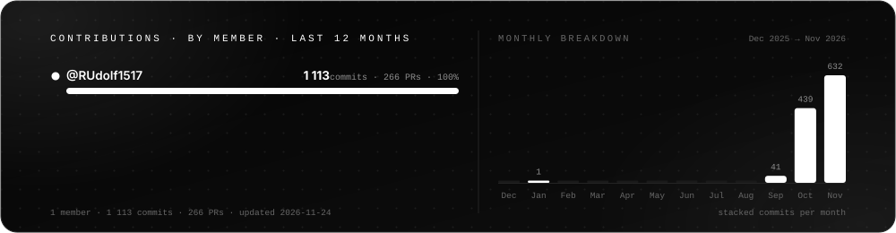

<picture>
  <source media="(prefers-color-scheme: dark)" srcset="https://raw.githubusercontent.com/Neuroslop-League/.github/main/assets/banner-dark.svg">
  <source media="(prefers-color-scheme: light)" srcset="https://raw.githubusercontent.com/Neuroslop-League/.github/main/assets/banner-light.svg">
  
</picture>

<!-- =========================================================================
     МЕСТО ДЛЯ ТЕКСТА — ВВОДНОЕ ОПИСАНИЕ / МАНИФЕСТ
     Замени блок ниже на своё описание Лиги Нейрослопа.
     ========================================================================= -->

> *Здесь будет описание **Лиги Нейрослопа** — кто мы, зачем собрались и почему половина всего вокруг написана промптами.*

---

## О лиге

<!-- Сюда можно добавить основной текст: историю, принципы, правила приёма, ссылки на чаты/ресурсы. -->

*Место для текста о том, чем занимается организация и какие задачи решает.*

---

## Проекты

<!-- Заполняй таблицу по мере появления репозиториев в организации. -->

| Проект | Что это | Стек |
| :--- | :--- | :--- |
| **[project-1](https://github.com/Neuroslop-League)** | *Короткое описание первого проекта* | `Python` `AI` |
| **[project-2](https://github.com/Neuroslop-League)** | *Короткое описание второго проекта* | `Rust` `TypeScript` |
| **[project-3](https://github.com/Neuroslop-League)** | *Короткое описание третьего проекта* | `...` |

---

## Участники

<!-- Список участников. Чтобы пользователь учитывался на диаграмме коммитов ниже, добавь его логин в файл members.txt в корне репозитория .github. -->

| Участник | Роль / заметка | Профиль |
| :--- | :--- | :--- |
| **@RUdolf1517** | *описание / роль* | [github.com/RUdolf1517](https://github.com/RUdolf1517) |
| **@member-2** | *место для нового участника* | — |
| **@member-3** | *место для нового участника* | — |

---

## Активность всех участников

<picture>
  <source media="(prefers-color-scheme: dark)" srcset="https://raw.githubusercontent.com/Neuroslop-League/.github/main/assets/commits-dark.svg">
  <source media="(prefers-color-scheme: light)" srcset="https://raw.githubusercontent.com/Neuroslop-League/.github/main/assets/commits-light.svg">
  
</picture>

Карточки генерируются автоматически внутри репозитория без сторонних сервисов:
<a href="https://github.com/Neuroslop-League/.github/blob/main/scripts/gen_banner.py">gen_banner.py</a> рисует баннер,
<a href="https://github.com/Neuroslop-League/.github/blob/main/scripts/gen_org_stats.py">gen_org_stats.py</a>
собирает статистику из GitHub GraphQL API по всем логинам из
<a href="https://github.com/Neuroslop-League/.github/blob/main/members.txt">members.txt</a>
(и публичным участникам организации), а GitHub Actions обновляет SVG каждые 6 часов.
